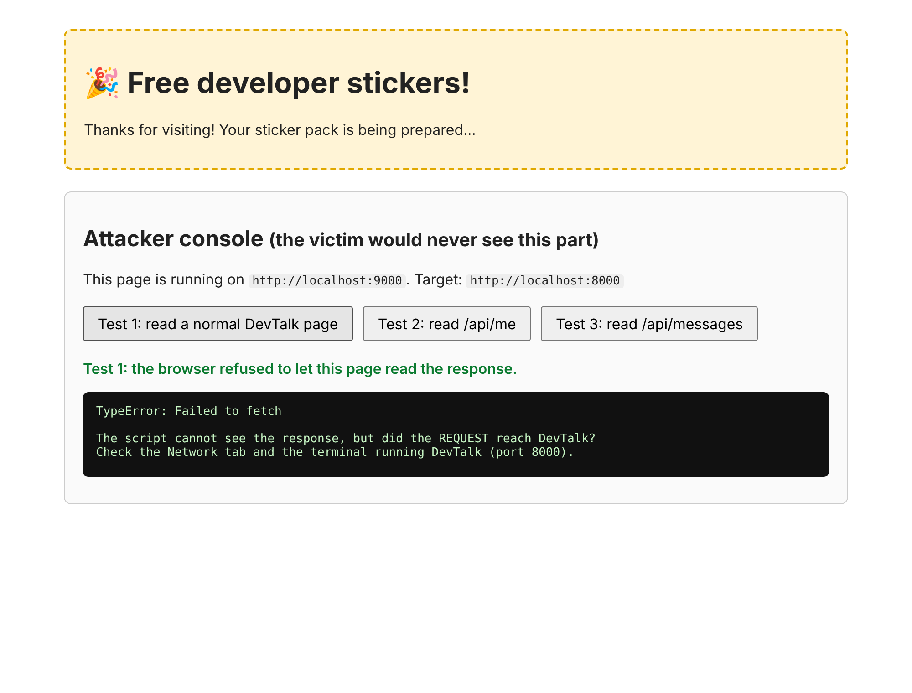
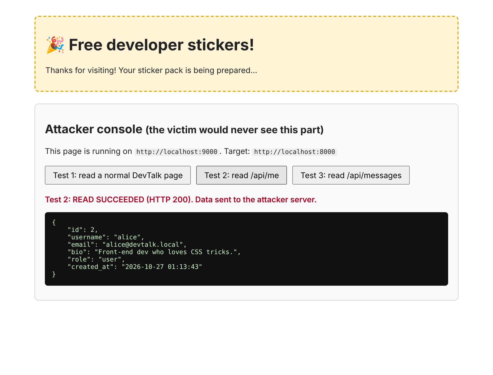
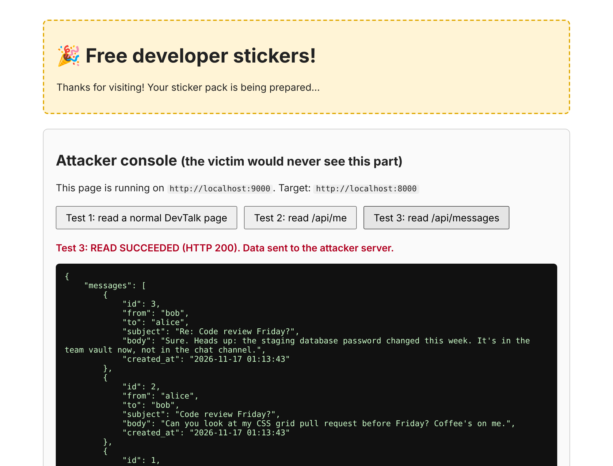
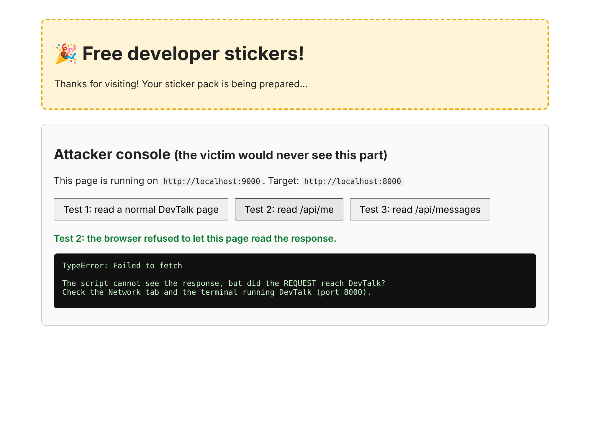
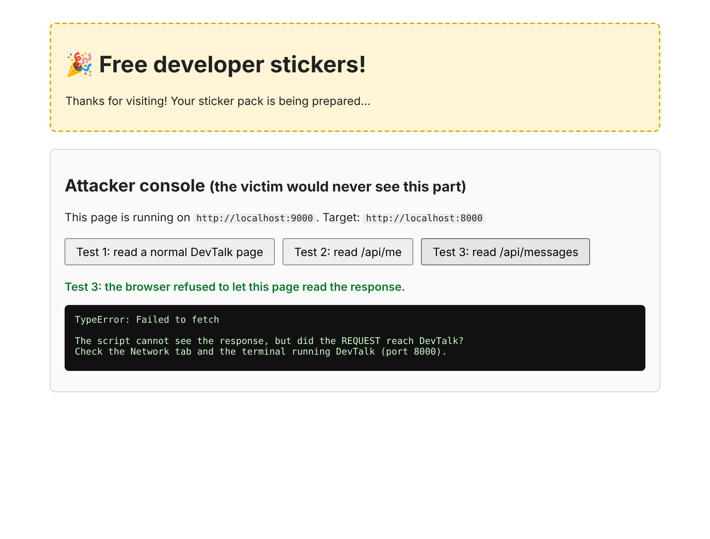
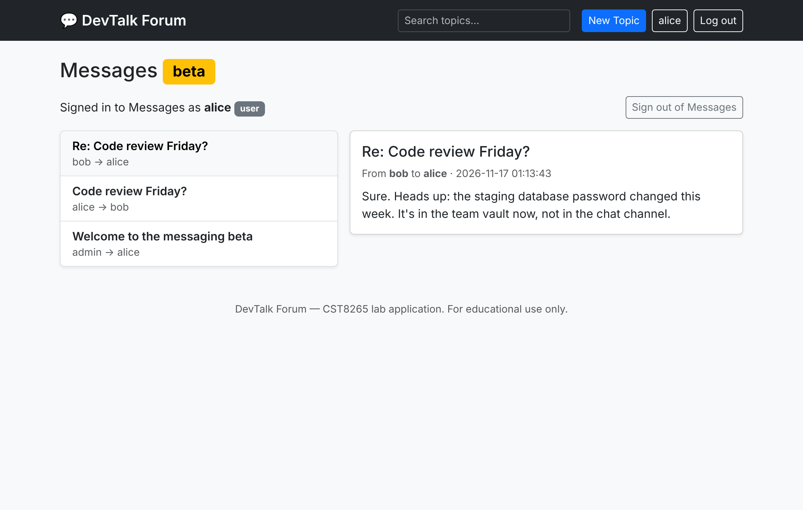

# Lab 8 — Browser and API Security

DevTalk with the Lab 8 API extension and Messages (beta) client.
Screenshots are in [`docs/screenshots/lab8/`](docs/screenshots/lab8/).

| Commit | What |
|---|---|
| `Lab 8 setup: merge DevTalk API extension and add browser security headers` | Extension merged (add-only), `reset-db` runs `api_seed.php`, `storage/` Git-ignored, security headers + single `session_set_cookie_params()` in `src/helpers.php` |
| `Lab 8 setup: Move inline handler to assets/app.js and enforce CSP` | Report-Only finding fixed; header switched to enforcing `Content-Security-Policy` |
| `Patch #A1: Replace reflected-origin CORS with an allowlist (A02 Security Misconfiguration)` | `src/api/cors.php` only |

The JWT signing key (`storage/jwt.key`) and the SQLite database are ignored by
Git (`git status --ignored` lists `storage/` and `database/forum.sqlite`). The
`attacker/` project is kept outside the repository and is not committed.

---

## Setup: Content-Security-Policy

With the header in `Content-Security-Policy-Report-Only` mode I visited every
page while logged in as alice: `login.php`, `register.php`, `index.php`,
`topic.php?id=1…5`, `edit_topic.php`, `create_topic.php`, `profile.php`,
`search.php`, and `messages.php`, including signing in to Messages and opening a message.

**Finding:** one violation, on every topic page:

> Executing inline event handler violates the following Content Security Policy
> directive 'script-src 'self' https://cdn.jsdelivr.net'. … The policy is
> report-only, so the violation has been logged but no further action has been taken.

Source: the Delete Topic form in `public/topic.php`:
`onsubmit="return confirm('Delete this topic?')"`.

**Fix (no `'unsafe-inline'`):** the form now carries
`data-confirm="Delete this topic?"`, and a new self-hosted script,
`public/assets/app.js` (loaded by `render_footer()`), listens for `submit` and
calls `confirm()` for any form that has `data-confirm`. Bootstrap is already
allowed from `https://cdn.jsdelivr.net`. The welcome banner is local, and
Bootstrap's `data:` SVG icons are covered by `img-src 'self' data:`.

After the fix the Console showed no CSP messages on any page. I then renamed the header to
`Content-Security-Policy` (enforcing) and re-checked. The Console was still clean, Bootstrap JS loaded, and
Messages worked. The delete confirmation still appears. **Cancel** keeps you
on the topic, and **OK** submits the form.

---

## Part A — CORS

### Test 1: reading a normal DevTalk page (`profile.php?id=2`)



- **Was the request sent? Did it carry a Cookie?** Yes. The browser sent
  `GET /profile.php?id=2` with alice's `PHPSESSID` cookie. `localhost:9000` and
  `localhost:8000` are the same *site*, so `SameSite=Lax` doesn't block it.
- **DevTalk's status:** `[200]: GET /profile.php?id=2`. DevTalk built and
  returned alice's profile page, including her email address.
- **Console:** `Access to fetch at 'http://localhost:8000/profile.php?id=2' from origin 'http://localhost:9000' has been blocked by CORS policy: No 'Access-Control-Allow-Origin' header is present on the requested resource.`
- The page sends no CORS headers, so the Same-Origin Policy stopped the
  attacker's script from **reading** the response. It did not stop the request.

### Tests 2 and 3: exploiting the misconfiguration (before the fix)




Both reads succeeded (HTTP 200). `collect.php` / `stolen.log` received alice's
full profile (`id`, `username`, `email: alice@devtalk.local`, `bio`, `role`,
`created_at`) and all three of her private messages. One of them is bob's note about the
staging database password.

**The two response headers that allowed it (on `/api/me`):**

```
Access-Control-Allow-Origin: http://localhost:9000
Access-Control-Allow-Credentials: true
```

**What `src/api/cors.php` did.** It copied whatever `Origin` the request sent
straight into `Access-Control-Allow-Origin` and added
`Access-Control-Allow-Credentials: true`. The comment calls it a "fix" because
the developer hit the browser's rule that `*` is not allowed with credentials.
Reflecting the origin makes that error go away. It also says "every origin is trusted,
with the user's cookies", which is worse than `*`. Any website a logged-in user
visits can read their API data.

**Why was alice's cookie sent at all?** `api_user()` (`src/api/api.php`, line 73)
falls back to the website's session cookie when there is no Bearer token. The
browser attached `PHPSESSID` because `credentials: 'include'` was set and
`localhost:9000` → `localhost:8000` is a *same-site* request (SameSite compares
the registrable domain, not the port), so `Lax` allowed it. On the real
internet (`attacker.example` → `devtalk.example`) Lax would have withheld the
cookie. In this lab, CORS was the only control left, and it was open.

### The fix: Patch #A1

`api_cors()` now:

- keeps an explicit allowlist, `API_CORS_ALLOWED_ORIGINS = ['http://localhost:5173']`;
- compares with `in_array($origin, $list, true)`, an exact strict comparison
  with no `str_contains`, `str_ends_with`, `strpos` or regex;
- never allows `null`;
- sends `Vary: Origin` on every API response, because it runs before routing,
  so 401, 404 and 500 responses get it too;
- sends `Access-Control-Allow-Origin` and `-Credentials` only to an allowed origin.
  Preflight `Allow-Methods`/`Allow-Headers` likewise go only to an allowed
  origin, and every other preflight gets a bare `204` with no
  `Access-Control-*` headers.

Header check with `curl`:

| Request `Origin` | ACAO / ACAC sent? |
|---|---|
| none | no (`Vary: Origin` only) |
| `http://localhost:9000` | no |
| `http://localhost:5173` | **yes** |
| `null` | no |
| `http://localhost:5173.evil.example` | no |
| `http://evil-localhost:5173` | no |
| `https://localhost:5173` (wrong scheme) | no |
| `OPTIONS` from `:5173` | yes, plus Methods / Headers / Max-Age |
| `OPTIONS` from `:9000` or `null` | no `Access-Control-*` at all |

### Verify: the attack fails




Console error after the fix:

```
Access to fetch at 'http://localhost:8000/api/me' from origin 'http://localhost:9000' has been blocked by CORS policy: No 'Access-Control-Allow-Origin' header is present on the requested resource.
Access to fetch at 'http://localhost:8000/api/messages' from origin 'http://localhost:9000' has been blocked by CORS policy: No 'Access-Control-Allow-Origin' header is present on the requested resource.
```

`stolen.log` stayed empty.

### But the request still arrived

DevTalk's terminal after the fix:

```
[200]: GET /api/me
[200]: GET /api/messages
```

Both requests still reached DevTalk, carried alice's cookie, and were answered
`200` with her data. The browser simply refused to hand that response to the
attacker's script. **CORS protects the *reading* of responses in a browser. It
is not access control.** It doesn't stop a request from being sent or processed, so
state-changing "simple" requests (form POSTs) still need CSRF tokens and
SameSite cookies. It does nothing against non-browser clients like `curl`, and
it doesn't replace server-side authentication and authorization.

### Trusted origins still work

I changed the attacker's `composer.json` start script to
`php -S localhost:5173 -t public` and ran the tests from `http://localhost:5173/cors.html`:


Tests 2 and 3 succeeded again. The allowlist works exactly as written:
**every origin on it can read logged-in users' data**, so whoever controls
`localhost:5173` (or anything that can run script there, such as an XSS) has the same access.
Keep the list as short as possible. I then restored the attacker server to port 9000.

### Regression check



`messages.php` is same-origin and needs no CORS. Signing in as alice lists
her 3 messages, and opening one shows it.

---

## Part B — Session cookie vs JWT

### The session cookie

| Attribute | `PHPSESSID` |
|---|---|
| HttpOnly | ✓ (true) |
| Secure | ✗ (false). DevTalk runs on plain `http://localhost`; `secure` is enabled automatically when served over HTTPS |
| SameSite | Lax |

`document.cookie` returns `""`. **PHPSESSID is not in the result** because it is
`HttpOnly`: the browser sends it with requests but never exposes it to
JavaScript, so an injected script can't read it.

### The token

`signIn()` in `public/assets/messages.js` stores the token with
`localStorage.setItem('devtalk_token', data.token)`, and `api()` reads it back
and sends it on every call as `Authorization: Bearer <token>`. It shows up under
Application → Local Storage → `http://localhost:8000` → `devtalk_token`.

### Decoded

Header:

```json
{ "alg": "HS256", "typ": "JWT" }
```

Payload:

```json
{
  "iss": "devtalk",
  "sub": 2,
  "username": "alice",
  "email": "alice@devtalk.local",
  "role": "user",
  "iat": 1795223698,
  "exp": 1795252498
}
```

| Claim | Meaning |
|---|---|
| `iss` | Issuer: the system that created the token (`devtalk`) |
| `sub` | Subject: the user the token is about, alice's user id `2`. `api_user()` uses it to look her up |
| `username` | alice's username |
| `email` | alice's email address |
| `role` | Role at issue time (`user`). Informational: the API re-reads the user from the database |
| `iat` | Issued-at time (Unix seconds) |
| `exp` | Expiry time (Unix seconds). After this, `jwt_decode()` returns null |

**Personal information:** `email` (and `username`, which identifies alice;
`sub` links to her account). Anyone who holds or logs the token can read it,
because the payload is encoded, not encrypted.

**Lifetime:** `exp − iat = 28 800 s = 8 hours` (`API_JWT_LIFETIME = 8 * 60 * 60`
in `src/api/jwt.php`).

**Why not paste tokens into JWT-decoder websites?** The token *is* the
credential: whoever holds it is alice, with no password, for up to 8 hours, and
there is no server-side way to revoke it. Pasting it into a third-party site
hands a live bearer credential, plus the personal data in the payload, to someone
you don't control. "Decodes only in your browser" is a promise you can't
verify. The page's JavaScript can change at any time, be compromised, or
include analytics/extensions that capture the input, and the token may end up
in history, logs or caches. Decoding it yourself needs three lines of JavaScript.

### Encoded is not encrypted, but it is signed

The forged token (`role` changed to `admin`, original signature) got:

```
401 {"error": "Invalid or expired token."}
```

The rejecting line is `src/api/jwt.php` line 64:

```php
if ($given === false || !hash_equals($expected, $given)) {
```

The server recomputes `HMAC-SHA256(header.payload, secret)` over the
*modified* payload, and it no longer matches the signature. Without the secret
key in `storage/jwt.key`, a client can read claims but can't change them.

### What XSS could do with each credential

- `document.cookie` → `""`. The injected script **can't read** the
  HttpOnly session cookie. It can still *use* it while the victim's tab is open, by making
  requests the browser attaches it to.
- `localStorage.getItem('devtalk_token')` → the full JWT. The injected script
  **can read and steal** the token.

Replaying the stolen token from a terminal, with no browser and no cookie:

```bash
curl -s http://localhost:8000/api/messages -H "Authorization: Bearer <token>"
```

This returns alice's messages (HTTP 200).

**After "Sign out of Messages"** (which removed `devtalk_token` from
localStorage), the same `curl` command **still returns alice's messages**.
Signing out only deleted the browser's copy. A JWT is stateless and
self-contained: the server checks only the signature and `exp`, and keeps no
session to destroy or revocation list to consult. The stolen copy stays valid
until it expires, up to 8 hours after it was issued. Real fixes include short
access-token lifetimes with refresh tokens, a server-side denylist or token
version per user, rotating the signing key, or keeping the credential in an
HttpOnly cookie instead of localStorage.
